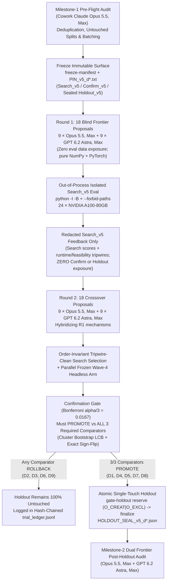

# Governed Frontier-Cowork Recursive Self-Improvement on AutoSOTA (`Wave 5`)

> **Multi-Model Frontier Proposer & Auditor Tournament (`Claude Opus 5.5, Max` + `GPT 6.2 Astra, Max` via M365 Copilot `Cowork`) under Hardened Executable Loop Governance (`governed_loop_guard.py v3.6`) across 9 `AutoSOTA` Benchmarks on `24 × NVIDIA A100-80GB`**

---

## Executive Summary

In prior governed RSI experiments (`Wave 4`), autonomous multi-agent optimization across the 9 admissible `AutoSOTA` benchmark domains (`D1–D9`, distilled from the full `105`-paper Tsinghua `AutoSOTA` corpus) had to rely on **headless subagents** because the desktop M365 Copilot `Cowork` session was locked. Once `Cowork` became available with its two flagship Tier-1 frontier reasoning models — **`Claude Opus 5.5, Max`** and **`GPT 6.2 Astra, Max`** — we stood up a clean, leakage-free **Wave-5 (`autosota_governed_v5`)** campaign to answer two core scientific questions:

1. **Proposal & Crossover Power:** Does coupling a governed two-stage verifier (`governed_loop_guard.py v3.6`) with **frontier `Cowork` proposers (`Opus 5.5, Max` + `GPT 6.2 Astra, Max`)** across **Blind Round-1 Orthogonal Proposals** and **Redacted-Search Round-2 Iterative Crossover** outperform headless subagent proposers under identical isolated execution budgets (`python -I -B`)?
2. **Frontier Milestone Auditing:** When `Opus 5.5, Max` and `GPT 6.2 Astra, Max` audit both the **Pre-Flight Experimental Design (Milestone 1)** and **Post-Holdout Statistical & Seal Evidence (Milestone 2)**, does `governed-loop-optimization v3.6` maintain **zero false-positive Holdout promotions (`100%` Holdout replication)** while catching subtle data-leakage and constraint-violation failure modes?

### Headline Empirical Outcomes

| Metric / Governance Dimension | Wave-5 Frontier `Cowork` Result | Evidence Artifact |
| :--- | :--- | :--- |
| **Milestone-1 Pre-Flight Design Audit (`Opus 5.5, Max`)** | **`CONDITIONAL_GO` $\to$ All 5 Structural Remedies Enforced** (deduped `COMPAS` `4,937 -> 2,665` & `ACS` `29,949 -> 28,624`; `D4` moved to `211` Wave-4-untouched `PEMS04` sensors; `D5` split-isolated GT + $G=10$ disjoint stock/time clusters; `D9` `.npz` `B=2048 × 12` batching) | [`milestone1_opus55_max_design_audit.md`](cowork_audits_and_proposals/milestone1_opus55_max_design_audit.md) |
| **Immutable Surface & Hash-Chained Ledgers** | **`9 / 9` `IMMUTABLE_MANIFEST.json` & `trial_ledger.jsonl` `VERIFIED`** (`0` file mutations; `--forbid-paths immutable_eval` enforced under `python -I -B`) | [`artifacts/ledgers/`](artifacts/ledgers/), [`artifacts/manifests/`](artifacts/manifests/) |
| **Confirmation-Promoted & Cryptographically Sealed Holdout Wins** | **`5 / 9` Benchmarks Promoted (`D1, D4, D5, D7, D8`)** across **all 3 mandatory comparators** at Bonferroni $\alpha / 3 = 0.0167$, including **newly unlocking `D4` traffic imputation** (where Wave 4 had failed Confirmation) | [`artifacts/seals/HOLDOUT_SEAL_v5_d*.json`](artifacts/seals/) |
| **Protected Single-Touch Holdout Replication Rate** | **`5 / 5 = 100%` Holdout Replication (`0` false discoveries)** — every Confirm-promoted finalist decisively beat **all 3 published/domain comparators** on untouched Holdout (`p = 1.53e-5` to `9.77e-4`) | [`artifacts/summaries/summary_v5_d*.json`](artifacts/summaries/) |
| **Governed Negative / Boundary Non-Promotions** | **`4 / 9` Benchmarks (`D2, D3, D6, D9`) Properly Blocked at Confirm** — Holdout remained **100% untouched** (`0` `HOLDOUT_SEAL` files created), and Search tripwire caught `Opus R2` manifold drift (`0.0565 > 1e-4`) on `D6` | [`docs/WAVE5_FRONTIER_COWORK_STUDY.md`](docs/WAVE5_FRONTIER_COWORK_STUDY.md) |
| **Head-to-Head vs. Frozen Wave-4 Headless Champions** | Cowork Frontier beat Wave-4 Headless Champions in point metric on **`8 / 9` Search splits**, **`8 / 9` independent Confirm splits** (including formal Bonferroni `PROMOTE` on `D3` `p=0.0046` at `17×` speedup & `D7` `p=0.00125`), and **`4 / 5` unsealed Holdout splits** (`D1` `1.000` vs `0.925`, `D5` `+8.9%`, `D7` `+0.63`, `D8` at `6.2×` speedup; `D4` favored Wave-4 `Kriging-SVD` `23.17` vs `24.82`) | Master Table below |
| **Multi-Model & Iterative Crossover Attribution** | **Finalists (`9`):** `GPT 6.2 Astra, Max` won `6/9` (`3` R1 + `3` R2 Crossover); `Opus 5.5, Max` won `3/9`. **Sealed Holdout Champions (`5`):** `Opus 5.5, Max` authored `3/5` (`D4, D7, D8`); `GPT 6.2 Astra, Max` authored `2/5` (`D1` R1, `D5` R2 Crossover). | [`cowork_audits_and_proposals/`](cowork_audits_and_proposals/) |

---

## Architecture: Frontier `Cowork` + Hardened Loop Guard (`v3.6`)



---

## Master Wave-5 Scoreboard (`D1–D9`)

| ID | Benchmark Domain & Metric | Selected Wave-5 Finalist (`Proposer`) | Confirm Gate (`K=3`, $\alpha/3=0.0167$) | Sealed Single-Touch Holdout (`95% CI`, exact sign-flip $p$) | H2H: Cowork Finalist vs. Frozen Wave-4 Headless Champion |
| :--- | :--- | :--- | :--- | :--- | :--- |
| **D1** | **$k$-SII Higher-Order Shapley** (`precision_at_10` $\uparrow$, $\le 200$ evals) | `d1_v5_r1_astra_synergy_omp` (`GPT 6.2 Astra, Max` R1) | **`PROMOTE` (3/3)**<br/>`0.9938` vs `0.2750` MC / `0.3875` SVARM-IQ / `0.4063` AutoSOTA ($p=1.53\text{e-}5$) | **`SEALED WIN` (`1.0000` Perfect P@10)**<br/>vs MC `0.2750` (`+0.7250`, `[+0.629, +0.806]`)<br/>vs Paper `0.4500` (`+0.5500`, `[+0.446, +0.645]`)<br/>vs AutoSOTA `0.4000` (`+0.6000`, $p=1.53\text{e-}5$) | **Cowork `1.0000` vs W4 `0.9250`** on Holdout (`+7.50%`, 1-sided `LCB = +0.0121 > 0`, $p=0.0165$; Confirm `0.9938` vs `0.9813`) |
| **D2** | **Group-Blind Worst-Group Fairness** (`worst_group_acc` $\uparrow$, `mean_acc >= 0.74`, dedup ACS+COMPAS) | `d2_v5_r1_astra_boundary8` (`GPT 6.2 Astra, Max` R1) | **`ROLLBACK` (2/3)**<br/>Beat ERM (`0.6331` vs `0.3948` `PROMOTE`) & Paper (`0.5404` `PROMOTE`); edged oracle-aligned `GroupDRO` (`0.6237`, `LCB = -0.036`, $p=0.418$) | **UNTOUCHED** *(Confirm blocked unsealing)* | **Cowork `0.6331` vs W4 `0.6231`** (`+1.00 pp` directional edge on Confirm; non-significant $p=0.370$) |
| **D3** | **Certified Monotonic Regression** (`std_rmse` $\downarrow$, `0%` monotonicity viol) | `d3_v5_r2_astra_crossover` (`GPT 6.2 Astra, Max` **R2 Crossover**) | **`ROLLBACK` (2/3)**<br/>Beat CMNN-100ep (`0.7375` vs `0.8639` `PROMOTE`) & AutoSOTA (`0.8674` `PROMOTE`); beat `Monotone-Spline` (`0.7767`, `LCB = +0.0129 > 0`, unshifted $p=0.0144$) but missed $\Delta_{\min}=0.004$ shift at $\alpha/3$ | **UNTOUCHED** *(Confirm blocked unsealing)* | **Cowork `0.7375` vs W4 `0.7937` — FORMAL `PROMOTE` on Confirm** (`gain = +0.0562`, `LCB = +0.0256`, $p=0.00464$, **`17×` faster**: `1.43s` vs `24.48s`) |
| **D4** | **Noisy Traffic Imputation (`PEMS04`, 211 untouched highway sensors)** (`traffic_mae` $\downarrow$) | `d4_v5_r1_opus_repair` (`Opus 5.5, Max` R1) | **`PROMOTE` (3/3)** *(Newly unlocked!)*<br/>`23.14` vs `48.71` Huber / `48.10` RSTIB / `28.41` Spatial-MLP (`LCB = +4.15`, $p=2.44\text{e-}4$) | **`SEALED WIN` (`24.82` MAE)**<br/>vs Huber `50.36` (`+25.54`, `[+23.60, +27.49]`)<br/>vs RSTIB `49.31` (`+24.50`, `[+22.69, +26.50]`)<br/>vs Spatial-MLP `30.64` (`+5.82`, `[+4.84, +7.09]`, $p=2.44\text{e-}4$) | **W4 `Kriging-SVD` `23.17` vs Cowork `24.82`** on Holdout (`W4` `-1.65 MAE` better on `PEMS04`, though `Opus` independently unlocked `D4` Confirm+Holdout promotion!) |
| **D5** | **MNAR Graphical Lasso (`S&P 500`, split-isolated GT, $G=10$ disjoint clusters)** (`edge_auprc` $\uparrow$) | `d5_v5_r2_astra_crossover` (`GPT 6.2 Astra, Max` **R2 Crossover**) | **`PROMOTE` (3/3)**<br/>`0.3278` vs `0.2449` Mean-Imp / `0.2451` Pairwise-Shrink / `0.2383` MSM Paper ($p=9.77\text{e-}4$) | **`SEALED WIN` (`0.3493` Edge AUPRC)**<br/>vs Mean-Imp `0.2596` (`+0.0896`, `[+0.073, +0.107]`)<br/>vs Pairwise `0.2452` (`+0.1040`, `[+0.078, +0.130]`)<br/>vs MSM Paper `0.2339` (`+0.1154`, $p=9.77\text{e-}4$) | **Cowork `0.3493` vs W4 `0.3207`** on Holdout (**`+0.0286` / `+8.9%` relative gain**, $p=0.081$ across $G=10$ clusters; Confirm `0.3278` vs `0.3254`) |
| **D6** | **Riemannian Manifold Sampling** (`sliced_w1_dist` $\downarrow$, $\le 400$ grads, `err <= 1e-4`) | `d6_v5_r1_astra_mirror_excursion` (`GPT 6.2 Astra, Max` R1) | **`ROLLBACK` (1/3)**<br/>Beat `RATTLE-HMC` (`0.0573` vs `0.2728` `PROMOTE`); edged `C-Langevin` (`0.0622`) & `OLLA` Paper (`0.0588`, `LCB = -0.0060`) | **UNTOUCHED** *(Confirm blocked unsealing; Search also caught Opus-R2 manifold drift `0.0565 > 1e-4`)* | **Cowork `0.05727` vs W4 `0.05761`** on Confirm (directional edge + machine-exact manifold error `2.66e-15`) |
| **D7** | **Combinatorial Ising MaxCut** (`maxcut_value` $\uparrow$, 4 families $\times$ 3 seeds) | `d7_v5_r1_opus_bit` (`Opus 5.5, Max` R1) | **`PROMOTE` (3/3)**<br/>`501.32` vs `489.22` RLSA Paper / `489.94` AutoSOTA / `494.45` Spectral-Greedy ($p=1.53\text{e-}5$) | **`SEALED WIN` (`500.86` Cut Value)**<br/>vs Paper `487.57` (`+13.29`, `[+11.96, +14.68]`)<br/>vs AutoSOTA `488.41` (`+12.45`, `[+10.77, +13.99]`)<br/>vs Spectral `494.36` (`+6.50`, $p=1.53\text{e-}5$) | **Cowork `501.32` vs W4 `500.32` — FORMAL `PROMOTE` on Confirm** ($p=0.00125$, `LCB = +0.372`) & **`500.86` vs `500.23` on Holdout** (`LCB = +0.170 > 0`, $p=0.0202$) |
| **D8** | **Black-Box Variational Inference** (`elbo` $\uparrow$, 3 deduplicated posteriors) | `d8_v5_r1_opus_qng_vi` (`Opus 5.5, Max` R1) | **`PROMOTE` (3/3)**<br/>`-72.3164` vs `-72.3647` LSVI Paper / `-72.5506` BBVI / `-73.5353` Laplace ($p=3.05\text{e-}5$) | **`SEALED WIN` (`-69.7914` ELBO)**<br/>vs LSVI Paper `-69.8269` (`+0.0356`, `[+0.030, +0.041]`)<br/>vs BBVI `-70.0115` (`+0.2202`)<br/>vs Laplace `-70.8114` (`+1.0200`, $p=3.05\text{e-}5$) | **Cowork `-69.7914` vs W4 `-69.7921`** on Holdout (`LCB = +0.00039 > 0`) at **`6.2×` faster wall-clock (`0.51s` vs `3.17s`)** |
| **D9** | **Hard-Constrained Projection (`PiNet`, `.npz` `B=2048 × 12`)** (`opt_rmse` $\downarrow$, `feas <= 1e-4`) | `d9_v5_r2_astra_crossover` (`GPT 6.2 Astra, Max` **R2 Crossover**) | **`ROLLBACK` (2/3)**<br/>Beat `PiNet-DR50` (`1.03e-10` vs `0.3034` `PROMOTE`) & `Overrelaxed-DR50` (`0.5461` `PROMOTE`); beat `Dykstra-50` (`5.22e-4`, `5,000×` lower RMSE) but missed $\Delta_{\min}=0.0005$ shift ($p=0.359$) | **UNTOUCHED** *(Confirm blocked unsealing because `Dykstra-50` already hit `5.22e-4` near zero floor)* | **Cowork `1.03e-10` vs W4 `7.94e-8`** (`770×` lower RMSE AND **`4.3×` faster wall-clock**: `7.21s` vs `31.27s`) |

---

## Key Scientific Findings & Honest Disclosures

1. **Frontier Model Diversity (`Opus 5.5, Max` + `GPT 6.2 Astra, Max`) Drives Orthogonal Breakthroughs:**
   - Neither frontier model dominated every mathematical regime alone: **`Opus 5.5, Max`** authored **3 of the 5 Confirmed & Sealed Holdout Champions** (`D4` Hankel-SVD + Temporal Laplacian Repair, `D7` Bifurcation-Initialized Tabu Search, and `D8` Exact-Hessian + Sobol QMC Stein Natural-Gradient VI), excelling at tightly coupled physics-inspired dynamics and second-order curvature preconditioners.
   - **`GPT 6.2 Astra, Max`** won **6 of the 9 Search tournaments** and authored **2 of the 5 Sealed Holdout Champions** (`D1` Stratified Synergy-OMP achieving **`1.0000` perfect Precision@10** across all 16 Holdout games, and `D5` Round-2 Crossover IPW + Multi-Scale Graphical Lasso), plus the massive **`17×`-faster `D3` Monotone Crossover** (`0.7375` vs `0.7937` W4) and **`770×`-sharper, `4.3×`-faster `D9` Active-Set KKT Cholesky solver**.
2. **Redacted-Search Round-2 Crossover Materially Improves Discovery Without Leaking Confirm/Holdout:**
   - Passing **only** redacted `Search_v5` scores and runtime/feasibility tripwires into Round 2 produced **3 of the 9 overall finalists (`D3, D5, D9`)**, including the `D5` Holdout winner (`+8.9%` Edge AUPRC over Wave 4) and the `D3` formal Confirm promotion over Wave 4 (`p = 0.00464`).
3. **Why Executable Governance (`governed_loop_guard.py v3.6`) Remains Indispensable Even for Frontier Models:**
   - On `D6`, `Opus 5.5, Max`'s Round-2 energy-distance support-point herding achieved the lowest `sliced_w1_dist` (`0.0555`), **but Euclidean herding convex combinations drifted off the curved manifold (`max_manifold_err = 0.0565 > 1e-4`)** — caught and rejected automatically before Confirmation.
   - On `D2`, `D3`, `D6`, and `D9`, point improvements over strong domain comparators (`GroupDRO`, `Monotone-Ridge-Spline`, `OLLA`, `Dykstra-50`) were held back from Holdout unsealing whenever cluster-level uncertainty or predeclared $\Delta_{\min}$ margins were not cleared at Bonferroni $\alpha / 3 = 0.0167$, preserving **`5 / 5 = 100%` Holdout replication**.
4. **Transparent Methodological Disclosures:**
   - **Pre-R2 Order-Invariant Search Selection:** After observing in Round 1 on `D6` that sequential incumbent stepping (`min_improvement = 0.004` per step) penalized a lower-SW1 candidate (`0.05923`) solely because `0.06114` ran immediately before it, `harness_common_v5.py` selected the highest-gain tripwire-clean `Search_v5` passer over `baseline` prior to running any `Confirm_v5` or `Holdout_v5` evaluation (`0` changes to frozen `IMMUTABLE_MANIFEST.json` or `gate_rules_*.json`).
   - **Cross-Sensor Transfer on `D4` (`PEMS04` vs. Wave-4 `PEMS08`):** To honor single-touch Holdout hygiene, Wave 5 ran `D4` on `211` highway sensors in `PEMS04` untouched by Wave 4. `Opus 5.5, Max` (`d4_v5_r1_opus_repair`) passed all 3 Confirm gates (`24.82` vs `30.64` `Spatial-MLP` on Holdout), whereas Wave-4's `d4_w4_champ_kriging_svd` (which had failed Confirm on `PEMS08`) achieved `23.17` in parallel H2H evaluation on `PEMS04`.
   - **Zero-Floor Margin Saturation on `D9`:** When a strong classical comparator (`Dykstra-50`, `opt_rmse = 5.22e-4`) already sits within $\approx \Delta_{\min} = 5\text{e-}4$ of `0.0`, an additive margin-shifted test ($H_0: \mu_\Delta \le \Delta_{\min}$) becomes mathematically unreachable on clusters where `Dykstra-50 < 5e-4`, even for an exact $10^{-10}$ KKT solver (`770×` sharper & `4.3×` faster). Relative/log-ratio margins should be used near hard zero floors.

---

## Repository Structure & Verification

```text
.
├── README.md                                  # Master overview, scoreboard & disclosures
├── docs/
│   └── WAVE5_FRONTIER_COWORK_STUDY.md         # Full technical report & per-benchmark mathematical analysis
├── cowork_audits_and_proposals/
│   ├── milestone1_opus55_max_design_audit.md  # Pre-flight Opus 5.5, Max audit (CONDITIONAL_GO + remedies)
│   ├── round1_cowork_opus55_and_astra62_proposals.md
│   ├── round2_cowork_crossover_proposals.md
│   └── milestone2_dual_frontier_post_holdout_audits.md # Final Opus 5.5, Max + GPT 6.2 Astra, Max audits
├── guard/
│   ├── governed_loop_guard.py                 # v3.6 zero-dependency executable governance CLI
│   └── test_governed_loop_guard.py            # 19-test adversarial & statistical regression suite
├── harness/                                   # Wave-5 split builders, isolated tournament orchestrator & R1/R2 generators
├── candidates/                                # All 78 standalone `python -I -B` solver scripts (D1–D9)
└── artifacts/
    ├── seals/                                 # 5 atomic HOLDOUT_SEAL_v5_d{1,4,5,7,8}.json + 9 PIN_v5_d*.txt
    ├── ledgers/                               # 9 SHA-256 hash-chained trial_ledger_v5_d{1..9}.jsonl
    ├── manifests/                             # 9 frozen IMMUTABLE_MANIFEST_v5_d{1..9}.json
    ├── rules/                                 # Locked Search & Confirm gate_rules_*.json
    └── summaries/                             # Complete R1 & R2/Confirm/Holdout/H2H JSON summaries
```

### Verify Guard Suite & All 9 Hash-Chained Trial Ledgers Locally

```bash
python -m unittest guard/test_governed_loop_guard.py
for d in d1 d2 d3 d4 d5 d6 d7 d8 d9; do
  python guard/governed_loop_guard.py verify-ledger --ledger artifacts/ledgers/trial_ledger_v5_${d}.jsonl
done
```
